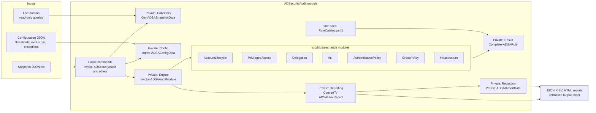
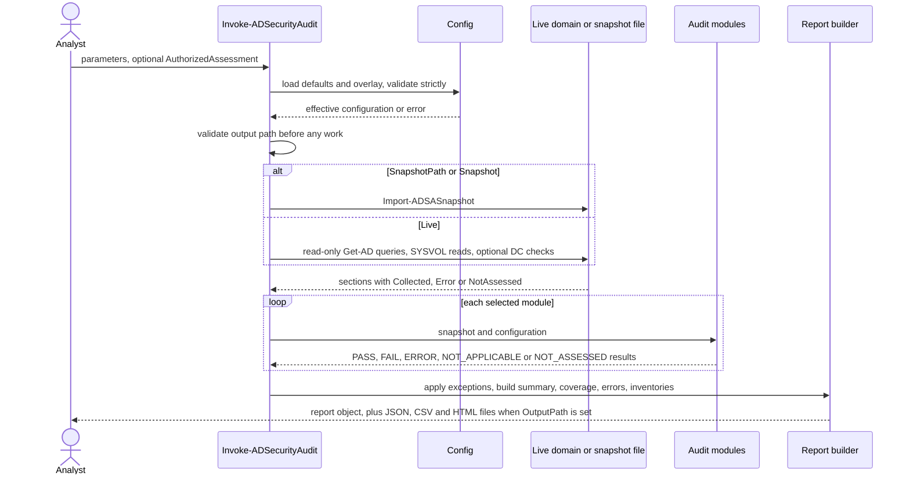

# User guide

Contents: [Concepts](#concepts) | [Architecture](#architecture) | [Audit workflow](#audit-workflow) | [Modules and rules](#audit-modules-and-rules) | [Result statuses](#result-statuses) | [Report format](#report-format) | [Command reference](#command-reference) | [Snapshots](#snapshots)

## Concepts

- **Snapshot**: normalized directory data (users, computers, groups, domain controllers, password policy, trusts, selected ACLs, GPOs, per-DC settings). A snapshot is either *collected live* from a domain (`dataSource = Live`) or *loaded from JSON*. Synthetic fixtures are labelled `dataSource = Simulated`.
- **Section**: one part of a snapshot with its own status: `Collected`, `Error` (query failed, including access denied) or `NotAssessed` (skipped or module unavailable). A failed section makes the dependent rules `ERROR` or `NOT_ASSESSED`.
- **Rule**: a documented check with a stable ID such as `ADSA-ACC-001`. The [rule reference](rule-reference.md) lists all of them.
- **Finding**: one result of a rule for one object. Every finding carries rule ID, severity, affected object, evidence, explanation, confidence, remediation, collection time, limitations and data source.
- **Exclusion**: removes objects from a rule's scope (for example a decommissioned OU). It requires a documented reason and is counted in the rule's limitations.
- **Exception**: a documented, owned, time-boxed acceptance of a specific failing finding. The finding stays in the report, marked *excepted*, and is left out of the active severity counts.
- **Stale vs vulnerable**: stale and never-used account rules are `Hygiene` findings with `Low` severity. They suggest clean-up. They are not confirmed vulnerabilities, and the report says so.

## Architecture

Design points:

- **Collection is separate from analysis.** Audit modules are functions of *(snapshot, configuration)*. That is why they can be tested with synthetic data and why a snapshot can be analysed offline.
- **`Acl` and `Delegation` are independent modules.** They read only their own snapshot sections and shared result helpers; neither calls any other audit module, and each has its own test file.
- **Fail-safe engine.** If an audit module throws, every rule in that module becomes `ERROR`. If a rule returns nothing, it becomes `ERROR`. Silence is never `PASS`.
- **Rule catalog is data.** Titles, severities, remediation and limitations live in `src/Rules/RuleCatalog.psd1`; tests enforce that every catalog rule is implemented and every implemented rule is catalogued.

## Audit workflow

## Audit modules and rules

| Module | Rules | Data sections | What it covers |
|---|---|---|---|
| `AccountLifecycle` | ACC-001..008, SVC-001 | Users, Computers | Stale/never-used users, inactive computers, password never expires, no-preauth, DES/reversible, orphaned managers, service accounts with old passwords |
| `PrivilegedAccess` | PRV-001..008 | Users, Groups | Nested privileged membership with cycle detection, stale/disabled privileged accounts, privileged SPNs, Schema Admins, adminCount remnants |
| `Delegation` | DEL-001..004 | Users, Computers, DomainControllers | Unconstrained, protocol-transition, DC-targeting constrained, RBCD on DCs |
| `Acl` | ACL-001..004 | Acls, Gpos | High-risk rights, replication (DCSync-capable) rights, ownership, GPO write rights on selected objects |
| `AuthenticationPolicy` | POL-001..006, KRB-001, LDAP-001/002, DC-001, AUD-001/002 | PasswordPolicy, Users, DcHosts | Domain password/lockout policy, krbtgt age, LDAP signing/channel binding, Print Spooler, audit policy, Security log size |
| `GroupPolicy` | GPO-001..003 | Gpos | LM compatibility level, SMB signing, GPP `cpassword` |
| `Infrastructure` | INF-001..004 | DomainControllers, Domain, Trusts | Unsupported DC OS, functional levels, trust SID filtering and selective authentication |

Select modules with `-Module`. Rules of unselected modules appear in coverage as `NOT_ASSESSED` ("Module was not selected").

## Result statuses

| Status | Meaning | Counted as active finding? |
|---|---|---|
| `PASS` | At least one object was evaluated and none violated the rule, within the stated limitations. Not a certification. | No |
| `FAIL` | An object violates the rule. | Yes, unless covered by a documented exception |
| `ERROR` | The check could not run (access denied, unreachable, LDAP error, module crash). **Never a pass.** | No, but listed as a coverage gap |
| `NOT_APPLICABLE` | Nothing in scope (for example no trusts exist). | No |
| `NOT_ASSESSED` | Data was skipped, unavailable or ambiguous (for example a required property was not retrieved). **Never a pass.** | No, but listed as a coverage gap |

A rule that evaluated some objects and could not evaluate others reports both, and the PASS result's limitations say how many were skipped. Coverage marks such rules **Partial**.

## Report format

JSON (schema: `config/schemas/report.schema.json`, validated by `Test-ADSAReport`):

| Property | Content |
|---|---|
| `SchemaVersion`, `Tool` | Report schema `1.x`; toolkit name and version |
| `Metadata` | `DataSource` (`Live`/`Simulated`), `AnalysisMode`, `CollectionTime`, `GeneratedAt`, domain name and functional levels, module list, warnings, notice, `Redacted` when applicable |
| `Summary` | Headline, counts by status, active findings by severity, excepted count, rules assessed vs not fully assessed |
| `Coverage` | Per-rule worst-case status with a *Partial* flag; per-section status, object count and error category |
| `CollectionErrors` | Source, target, category, message (sections, unreachable DCs, unreadable GPOs/ACL targets) |
| `Inventories` | Privileged groups (effective counts), service accounts (users with SPNs), domain controllers, trusts, enabled accounts with password-expiration exception |
| `Findings` | One object per result; fields below |

Finding fields: `RuleId`, `Title`, `Category`, `Module`, `Status`, `Severity`, `FindingType` (`Hygiene`, `Misconfiguration`, `PotentialRisk`, `Informational`), `AffectedObject`, `AffectedObjectType`, `Evidence`, `Explanation`, `Confidence`, `Remediation`, `CollectionTime`, `Limitations`, `DataSource`, `Excepted`, `Exception`.

CSV has one row per finding with the same columns (`Evidence` is compact JSON). Cells that start with `=`, `+`, `-` or `@` are prefixed with `'` to prevent spreadsheet formula injection.

HTML is a single self-contained file. It has an executive summary with a *top priorities* table, then findings **grouped by rule** (one explanation and remediation per rule, one row per affected object with its evidence), then exceptions, gaps, coverage, collection errors and inventories. Every value is HTML-encoded, CSS class names come from whitelists, there is no script and no external resource, and a restrictive `Content-Security-Policy` is set. It opens with a data-source banner.

## Command reference

| Command | Synopsis |
|---|---|
| `Invoke-ADSecurityAudit` | Runs the audit. Parameter sets: **Offline** (`-SnapshotPath`), **Object** (`-Snapshot`), **Live** (`-AuthorizedAssessment`, `-Server`, `-Credential`, `-SkipDcHostChecks`, `-SkipSysvol`, `-SkipAcls`, `-SaveSnapshotPath`). Common: `-ConfigPath`, `-Module`, `-OutputPath`, `-Format`, `-BaseName`, `-Redact`, `-RedactionSalt`, `-AllowUncOutput`, `-AllowRepositoryOutput`. Returns the report object; with `-OutputPath` it also has `OutputFiles`. |
| `Get-ADSASnapshot` | Collects a live snapshot. Requires `-AuthorizedAssessment`. |
| `Import-ADSASnapshot` | Loads and validates a snapshot file; throws on malformed input. |
| `Export-ADSASnapshot` | Writes a snapshot (sensitive) to a validated folder. |
| `Export-ADSAReport` | Writes `Json`, `Csv`, `Html`; validates the report schema first; `-Redact` pseudonymises names. |
| `Test-ADSAReport` | Validates a report object (`-Report`) or file (`-Path`); returns `IsValid` and `Errors`. |
| `Get-ADSAConfig` | Returns the effective configuration (defaults overlaid with `-Path`). Throws when invalid. |
| `Test-ADSAConfig` | Validates a configuration file without throwing; returns `IsValid`, `Errors`, `Warnings`. |
| `Get-ADSARuleCatalog` | Lists rules; filter with `-Id` (wildcards) or `-Module`. |
| `Test-ADSAPrerequisite` | Reports `OfflineReady`, `LiveReady` and individual checks. |

Scripts: `scripts/Invoke-Demo.ps1`, `Invoke-Tests.ps1`, `Invoke-Lint.ps1`, `Test-Documentation.ps1`, `New-RuleReference.ps1`, `New-SampleSnapshot.ps1`, `Install-DevDependencies.ps1`.

## Snapshots

A snapshot has `schemaVersion`, `dataSource`, `collectionTime`, `domain` and `sections`; each section has `status`, `data`, `error`, `errorCategory` (and optional `warnings`). Section data uses PascalCase property names such as `SamAccountName`, `UserAccountControl`, `LastLogonTimestamp`. A property that is present but empty means "not set"; a property that is absent means "not retrieved", and rules treat the two differently (absent leads to `NOT_ASSESSED`, never to a pass). See `sample-data/contoso-sim.snapshot.json` for a complete synthetic example and `config/schemas/snapshot.schema.json` for the envelope.

Collection principles: the toolkit collects the minimum needed (no user descriptions, no password hashes, no GPP secrets), and only attributes listed in `src/Private/Collectors.ps1`. Group member lists are fetched only for the configured privileged groups, Protected Users and the groups nested in them, so very large groups such as Domain Users are never downloaded; other groups carry `MembersCollected = false`.
