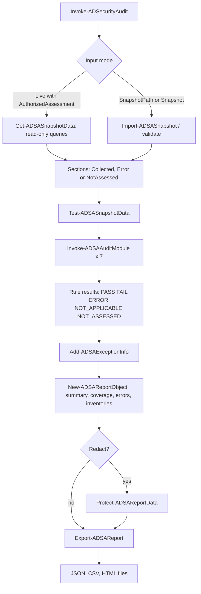

# Walkthrough: from clone to interpreting reports

This walkthrough takes you from `git clone` to a mock-based audit and then to reading its reports. It has three progressive exercises. **Exercises 1 and 2 use only synthetic data** and need no domain. **Exercise 3 is optional** and touches a real, explicitly authorized test domain.

> **What the mock exercises prove and do not prove.** They prove that the toolkit runs and that its rules behave as documented on invented data. They say nothing about the security of any real domain. Every report produced from the sample data is labelled `Simulated`.

Contents: [Setup](#setup) | [Exercise 1](#exercise-1-run-the-unit-tests-and-an-offline-audit) | [Exercise 2](#exercise-2-review-synthetic-findings) | [Exercise 3 (optional)](#exercise-3-optional-authorized-test-domain) | [Command reference](#command-reference) | [Workflow diagram](#architecture-and-audit-workflow)

## Setup

```powershell
git clone https://github.com/joeabur/Active-Directory-Security-Audit-Toolkit.git
Set-Location Active-Directory-Security-Audit-Toolkit
./scripts/Install-DevDependencies.ps1
Import-Module ./src/ADSecurityAudit.psd1 -Force
```

`Install-DevDependencies.ps1` is only needed for tests and lint (Pester 5.7.1, PSScriptAnalyzer 1.23.0, current user scope).

## Exercise 1: run the unit tests and an offline audit

**Goal:** prove your environment works and produce your first reports from mocked directory results.

**Prerequisites:** PowerShell 5.1 or 7+, Pester 5 (from the setup step), the cloned repository. No domain, no network access to a domain.

**Configuration:** none. The shipped defaults in `config/default.config.json` are used.

### Step 1: unit tests (mocked ActiveDirectory cmdlets)

```powershell
./scripts/Invoke-Tests.ps1 -Suite Unit
```

The unit tests use stub `Get-AD*` commands and synthetic data. Expected last lines:

```text
Tests Passed: <N>, Failed: 0, Skipped: 0, Inconclusive: 0, NotRun: 0
Passed: <N>  Failed: 0  Skipped: 0  NotRun: 0
```

`<N>` grows as tests are added. **Failed must be 0.** See [test results](test-results.md) for the numbers recorded when this documentation was written.

### Step 2: offline audit using the demo script

```powershell
./scripts/Invoke-Demo.ps1
```

Expected output (abridged; the numbers are deterministic for the sample data):

```text
DEMO: offline audit of SYNTHETIC data (no domain access, no network).
SIMULATED DATA: these results come from a synthetic fixture. ...
50 active finding(s) across 41 assessed rule(s); 5 rule(s) could not be fully assessed; 0 finding(s) covered by documented exceptions.
Critical      : 2
High          : 17
Medium        : 20
Low           : 11
Informational : 0
Reports written:
  .../output/demo/sample-report.json
  .../output/demo/sample-report.csv
  .../output/demo/sample-report.html
  .../output/demo/sample-report-redacted.json
  .../output/demo/sample-report-redacted.html
Demo self-checks passed.
```

### Step 3: the same audit by hand

```powershell
$report = Invoke-ADSecurityAudit -SnapshotPath ./sample-data/contoso-sim.snapshot.json -OutputPath ./output/exercise1
$report.Summary.ResultsByStatus
$report.Metadata | Select-Object DataSource, AnalysisMode, CollectionTime
```

Expected:

```text
PASS FAIL ERROR NOT_APPLICABLE NOT_ASSESSED
---- ---- ----- -------------- ------------
   6   50     5              1            1

DataSource AnalysisMode   CollectionTime
---------- ------------   --------------
Simulated  OfflineSnapshot 2026-10-01T00:00:00Z
```

### Evidence interpretation

- The **collection time** is fixed inside the sample (`2026-10-01`), so staleness is computed against that date, not today. That is what makes the demo repeatable.
- `DataSource = Simulated` means no number here describes a real environment.
- All five statuses appear by design: `PASS`, `FAIL`, `ERROR` (an unreachable simulated domain controller), `NOT_APPLICABLE` (lockout duration does not apply when lockout is disabled) and `NOT_ASSESSED` (a Windows Server 2025 controller where the tool refuses to assume a default).

### Success verification

```powershell
(Test-ADSAReport -Report $report).IsValid        # True
Test-Path ./output/exercise1/*.json              # True
$report.Findings | Where-Object { $_.RuleId -eq 'ADSA-ACL-002' -and $_.Status -eq 'FAIL' } | Select-Object -ExpandProperty AffectedObject
```

The last command prints the domain root DN, `DC=contoso-sim,DC=test`. You are done with the exercise when the report validates, three report files exist, and the demo prints `Demo self-checks passed.`

### Cleanup

```powershell
Remove-Item ./output -Recurse -Force
```

`output/` is untracked (`.gitignore`) and holds only synthetic data in this exercise.

## Exercise 2: review synthetic findings

**Goal:** learn to read a finding: affected object, evidence, confidence, finding type, limitations. You review stale-account, privileged-group and policy findings.

**Prerequisites:** Exercise 1 completed (or just run the first command below).

**Configuration:** defaults (stale user threshold 90 days, privileged group maximum from `privilegedGroupMaxMembers`, baseline password length 14).

```powershell
$report = Invoke-ADSecurityAudit -SnapshotPath ./sample-data/contoso-sim.snapshot.json -OutputPath ./output/exercise2
```

### 2a. A stale account is hygiene, not a vulnerability

```powershell
$report.Findings |
    Where-Object { $_.RuleId -eq 'ADSA-ACC-001' -and $_.Status -eq 'FAIL' } |
    Select-Object AffectedObject, Severity, Confidence, FindingType, @{ n = 'Days'; e = { $_.Evidence.DaysSinceLastLogon } }
```

Expected rows include:

```text
AffectedObject  Severity Confidence FindingType  Days
carol.stale     Low      Medium     Hygiene      606
mike.staleadmin Low      Medium     Hygiene      628
```

Interpretation:

- **Type `Hygiene`, severity `Low`, confidence `Medium`**: the account has not logged on for longer than the 90-day threshold. That suggests it may be unused; it does not show anyone can abuse it.
- The **limitations** field explains why confidence is only Medium: `lastLogonTimestamp` replicates lazily (up to about 14 days) and is not updated by every authentication type.
- The same account (`mike.staleadmin`) is also a member of Domain Admins. Look at rule `ADSA-PRV-002` next: a *stale privileged* account is rated **High**, because dormant privileged accounts are valuable and rarely watched. Context changes the risk; the toolkit keeps the two findings separate on purpose.

### 2b. Privileged group findings

```powershell
$report.Findings | Where-Object { $_.RuleId -eq 'ADSA-PRV-001' -and $_.Status -eq 'FAIL' } | Select-Object -ExpandProperty Evidence | Format-List
$report.Findings | Where-Object { $_.RuleId -eq 'ADSA-PRV-007' -and $_.Status -eq 'FAIL' } | Select-Object -ExpandProperty Evidence | Format-List
```

Expected evidence for `ADSA-PRV-001` (Domain Admins):

```text
EffectiveMemberCount : 6
Maximum              : 5
NestedGroupCount     : 2
SampleMembers        : {Administrator, alice.admin, mike.staleadmin, svc_backup...}
```

Interpretation:

- `bob.helpdesk` and `nina.ops` are **not direct members** of Domain Admins. They are members of `IT-Admins` and `Server-Ops-Team`, which are nested in Domain Admins. The toolkit resolves nesting, so effective membership is 6, over the configured maximum of 5.
- `IT-Admins` and `Server-Ops-Team` contain each other. `ADSA-PRV-007` reports the cycle (`IT-Admins > Server-Ops-Team > IT-Admins`). Cycles do not grant extra access, but naive membership checks loop forever; the toolkit detects and reports them instead.
- Type is `PotentialRisk`: the maximum is an organisational threshold you can change in [configuration](configuration.md).

### 2c. Policy findings

```powershell
$report.Findings | Where-Object { $_.RuleId -in 'ADSA-POL-001', 'ADSA-POL-004' } | Format-Table RuleId, Status, @{ n = 'Evidence'; e = { $_.Evidence | ConvertTo-Json -Compress } } -AutoSize
```

Expected:

```text
RuleId       Status Evidence
ADSA-POL-001 FAIL   {"MinPasswordLength":8,"Required":14}
ADSA-POL-004 FAIL   {"LockoutThreshold":0,"Maximum":10,"Note":"Account lockout is disabled"}
```

### 2d. Failures to collect are not passes

```powershell
$report.Findings | Where-Object { $_.Status -in 'ERROR', 'NOT_ASSESSED' } | Format-Table Status, RuleId, AffectedObject -AutoSize
$report.CollectionErrors | Format-Table Source, Target, Category -AutoSize
```

Expected collection errors:

```text
Source              Target Category
FineGrainedPolicies        AccessDenied
DcHosts             DC02   Unreachable
```

Interpretation: the simulated account could not read fine-grained password policies (readable only by Domain Admins by default) and `DC02` was unreachable. Five rules therefore report `ERROR` for `DC02`, and `ADSA-LDAP-001` reports `NOT_ASSESSED` for the Windows Server 2025 controller `DC03`. Rules with a mix of results are marked **Partial** in the coverage table.

### 2e. Open the HTML report

Open `output/exercise2/*.html`. Find the executive summary, one technical finding, the coverage table and the collection errors. Then try the redacted copy:

```powershell
$redacted = Invoke-ADSecurityAudit -SnapshotPath ./sample-data/contoso-sim.snapshot.json -Redact -RedactionSalt 'training'
$redacted.Findings | Where-Object { $_.RuleId -eq 'ADSA-ACC-001' -and $_.Status -eq 'FAIL' } | Select-Object -ExpandProperty AffectedObject
```

Account names such as `carol.stale` become `redacted-xxxxxxxx` tokens; well-known names such as `Domain Admins` and `krbtgt` stay readable.

### Success verification

You can answer: *Why is `carol.stale` Low severity and Medium confidence? Why is Domain Admins' effective membership 6 when only 5 names are listed directly? What does `NOT_ASSESSED` for `DC03` tell you?* Answers are in the interpretation notes above.

### Cleanup

```powershell
Remove-Item ./output -Recurse -Force
```

## Exercise 3 (optional): authorized test domain

> **OPTIONAL and only for an explicitly authorized test domain.** Do not run this against a production domain unless you hold written authorization and have agreed the scope, timing and data handling. The toolkit is read-only, but reading a directory still generates load, produces sensitive data, and may trigger security monitoring.

**Goal:** connect to a test domain, run selected read-only checks, and export a report.

### Prerequisites

| Item | Detail |
|---|---|
| Authorization | Written approval from the domain owner; named test domain |
| Host | Windows with PowerShell 5.1 or 7, RSAT `ActiveDirectory` module |
| Check | `Test-ADSAPrerequisite` shows `LiveReady = True` |
| Account | A standard authenticated domain user is enough for the steps below (see [permissions by module](security-and-limitations.md#permissions-by-module)) |
| Network | LDAP (389/636) and AD Web Services (9389) to a domain controller; WinRM (5985/5986) only for optional DC host checks; SMB (445) to read SYSVOL |
| Data handling | Output folder on an encrypted disk, access limited to you; plan retention and deletion |

Install RSAT if missing (Windows 10/11, elevated, one-time):

```powershell
Add-WindowsCapability -Online -Name 'Rsat.ActiveDirectory.DS-LDS.Tools~~~~0.0.1.0'
```

### Step 1: confirm the host can do live collection

```powershell
Import-Module ./src/ADSecurityAudit.psd1 -Force
(Test-ADSAPrerequisite).LiveReady
```

Expected: `True`. If `False`, read [troubleshooting](troubleshooting.md#the-activedirectory-module-is-missing).

### Step 2: run selected checks only (least invasive)

Start with account and policy modules and skip domain controller host checks, SYSVOL and ACLs:

```powershell
$cred = Get-Credential -Message 'Read-only account for the test domain'
$report = Invoke-ADSecurityAudit -AuthorizedAssessment -Server dc01.lab.example -Credential $cred `
    -Module AccountLifecycle, PrivilegedAccess, AuthenticationPolicy -SkipDcHostChecks -SkipSysvol -SkipAcls `
    -OutputPath ./output/live
```

`-AuthorizedAssessment` is mandatory for live collection; without it the command stops with an explanation. The credential exists only in memory for the session and is never written anywhere.

### Step 3: widen scope deliberately

```powershell
$report = Invoke-ADSecurityAudit -AuthorizedAssessment -Server dc01.lab.example -Credential $cred -SkipDcHostChecks -OutputPath ./output/live
```

Add DC host checks (WinRM; needs rights on each DC, see the permissions table) by removing `-SkipDcHostChecks`.

### Expected outputs

- `output/live/ADSA-report-<domain>-<timestamp>.json|csv|html`
- `$report.Metadata.DataSource` is `Live`, `AnalysisMode` is `LiveCollection`.
- Rules whose data could not be read show `ERROR` (access denied, unreachable, LDAP error) or `NOT_ASSESSED` (module unavailable, skipped). **They are never `PASS`.**
- Skipped sections appear in the coverage table as `NotAssessed` with category `Skipped`.

### Evidence interpretation

1. Read **Coverage** first: which rules were actually assessed, and which have gaps?
2. Read **Collection errors**: each has a source, target, category (`AccessDenied`, `Unreachable`, `LdapError`, `UnsupportedAttribute`, `ModuleUnavailable`) and message. [Troubleshooting](troubleshooting.md) explains each category.
3. Only then read findings. Treat `Hygiene` findings as clean-up candidates and `Misconfiguration` findings as items to verify with the owner before changing anything; the toolkit never changes anything itself.
4. Confidence and limitations tell you how much to trust each finding. Medium and Low confidence findings need human confirmation.

### Success verification

```powershell
(Test-ADSAReport -Report $report).IsValid
$report.Metadata.DataSource                                   # Live
$report.Coverage.Sections | Format-Table Section, Status, ObjectCount, ErrorCategory -AutoSize
$report.OutputFiles
```

Success means: the report validates, the sections you intended are `Collected` with non-zero object counts, and every non-collected section is explained in the collection errors. Compare a few results with what you know about the test domain (for example the real number of Domain Admins).

### Avoiding exposure of directory information

- Use a dedicated, encrypted output folder; do not use a network share (the toolkit refuses UNC paths unless `-AllowUncOutput` is given).
- The toolkit restricts output files to your account where the platform allows, and refuses to write into tracked repository folders. `output/` is git-ignored; never commit reports or snapshots.
- Use `-Redact` when sharing a report outside the assessment team. Redaction pseudonymises object names; it is not anonymisation.
- Do not use `-SaveSnapshotPath` unless you need to re-run offline; snapshots contain more detail than reports.
- Delete collected data when the engagement ends.

### Collection limitations to remember

- A single domain controller is queried (`-Server`); replication lag affects `lastLogonTimestamp` and recent changes.
- Selective ACL coverage (domain root, AdminSDHolder, privileged groups, Domain Controllers OU, DC objects, GPO containers); not an exhaustive attack-path analysis.
- Password and lockout rules evaluate the default domain policy only; fine-grained policies can override it.
- GPO rules read settings as defined in GPOs linked to the domain root and Domain Controllers OU; they do not compute resultant policy.
- Windows PowerShell 5.1 cannot import snapshots larger than its JSON parser limit; use PowerShell 7 for very large offline snapshots.

### Cleanup

```powershell
Remove-Variable cred, report
Remove-Item ./output/live -Recurse -Force
```

If you used `-SaveSnapshotPath`, delete that file too. Confirm nothing under `output/` is tracked: `git status` must be clean.

## Command reference

| Command | Purpose | Key parameters |
|---|---|---|
| `Invoke-ADSecurityAudit` | Run the audit and return a report; optionally write files | `-SnapshotPath`, `-Snapshot`, `-AuthorizedAssessment`, `-Server`, `-Credential`, `-Module`, `-ConfigPath`, `-OutputPath`, `-Format`, `-Redact` |
| `Get-ADSASnapshot` | Collect a live snapshot (read-only) | `-AuthorizedAssessment`, `-Server`, `-Credential`, `-SkipDcHostChecks`, `-SkipSysvol`, `-SkipAcls` |
| `Import-ADSASnapshot` | Load and validate a snapshot JSON file | `-Path` |
| `Export-ADSASnapshot` | Save a snapshot to JSON (sensitive) | `-Snapshot`, `-OutputPath`, `-FileName` |
| `Export-ADSAReport` | Write JSON/CSV/HTML from a report object | `-Report`, `-OutputPath`, `-Format`, `-BaseName`, `-Redact` |
| `Test-ADSAReport` | Validate a report object or file | `-Report`, `-Path` |
| `Get-ADSAConfig` | Load the effective configuration | `-Path` |
| `Test-ADSAConfig` | Validate a configuration file | `-Path` |
| `Get-ADSARuleCatalog` | List rules | `-Id`, `-Module` |
| `Test-ADSAPrerequisite` | Check host capabilities | none |
| `scripts/Invoke-Demo.ps1` | Repeatable offline demo | `-OutputPath` |
| `scripts/Invoke-Tests.ps1` | Run Pester | `-Suite` (Unit, Integration or All), `-CI` |
| `scripts/Invoke-Lint.ps1` | PSScriptAnalyzer | `-PassThru` |
| `scripts/Test-Documentation.ps1` | Validate docs, examples, schemas | `-PassThru` |

Full details: [user guide](user-guide.md#command-reference).

## Architecture and audit workflow

The architecture diagram is in the [user guide](user-guide.md#architecture). The workflow of one audit run:



## Next steps

- Tune thresholds and document exceptions: [configuration](configuration.md).
- Browse [examples](examples.md) for recipes.
- Review [security and limitations](security-and-limitations.md) before any real-domain use.
